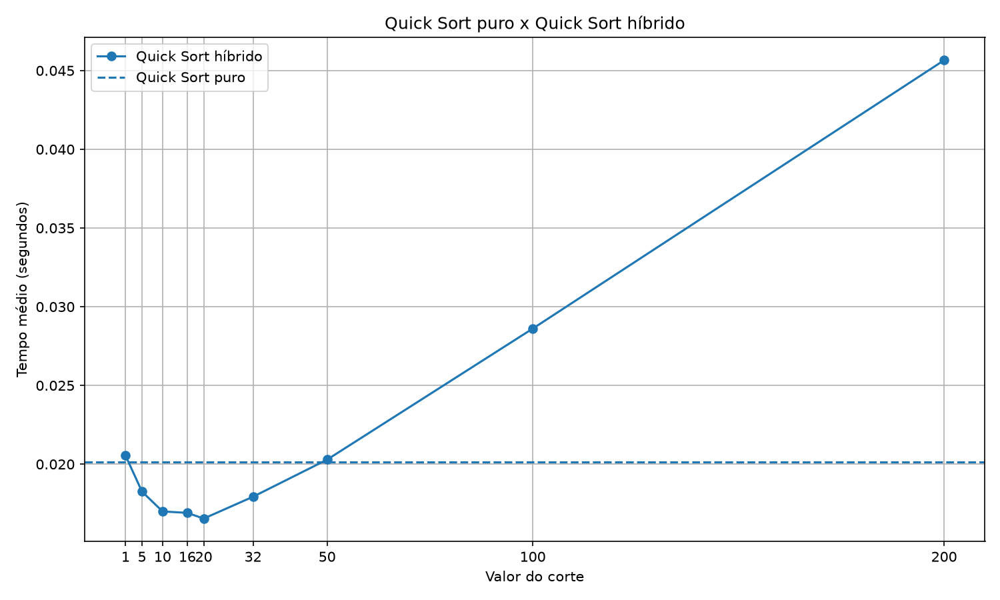

# Relatório — Quick Sort Híbrido

## 1. Objetivo

O objetivo deste trabalho é implementar uma versão híbrida do Quick Sort que utiliza o Insertion Sort para ordenar pedaços pequenos da lista. O experimento busca identificar qual valor de corte proporciona o melhor desempenho para uma lista de 20.000 elementos aleatórios.

## 2. Implementação

Foram implementadas duas versões do algoritmo:

- **Quick Sort puro:** utiliza pivô aleatório e divide os elementos em três grupos: menores, iguais e maiores que o pivô.
- **Quick Sort híbrido:** utiliza a mesma estratégia, mas chama o Insertion Sort quando o tamanho do pedaço é menor que o valor de corte definido.

O Insertion Sort pode ser eficiente em listas pequenas, enquanto o Quick Sort tende a apresentar bom desempenho em conjuntos maiores.

## 3. Metodologia

O experimento foi realizado com listas de 20.000 números aleatórios. Foram feitas cinco repetições para cada configuração, utilizando as mesmas listas de entrada para comparar os algoritmos.

Os cortes avaliados foram:

**1, 5, 10, 16, 20, 32, 50, 100 e 200.**

O tempo de execução foi medido com `time.perf_counter()`. Para cada corte, foi calculada a média dos tempos das cinco execuções. Os resultados foram armazenados no arquivo `resultados.csv`.

## 4. Resultados

A tabela apresenta os tempos médios obtidos e o ganho percentual em relação ao Quick Sort puro, cujo tempo médio foi de aproximadamente 0,020132 segundo.

| Corte | Tempo médio (s) | Ganho sobre o puro |
|---:|---:|---:|
| 1 | 0,020541 | -2,03% |
| 5 | 0,018259 | 9,30% |
| 10 | 0,016997 | 15,57% |
| 16 | 0,016908 | 16,01% |
| 20 | 0,016544 | 17,82% |
| 32 | 0,017933 | 10,92% |
| 50 | 0,020287 | -0,77% |
| 100 | 0,028610 | -42,11% |
| 200 | 0,045654 | -126,78% |

Valores positivos indicam redução do tempo em relação ao Quick Sort puro. Valores negativos indicam que o híbrido foi mais lento.

## 5. Gráfico

O gráfico abaixo compara os tempos médios do Quick Sort híbrido para cada corte com o tempo do Quick Sort puro.

## 6. Análise dos resultados

### 6.1 Melhor valor de corte

O melhor resultado foi obtido com **corte igual a 20**, que apresentou tempo médio de 0,016544 segundo.

Em comparação com o Quick Sort puro, que levou aproximadamente 0,020132 segundo, houve uma redução de aproximadamente **17,82% no tempo de execução**.

Esse resultado indica que, neste experimento, utilizar o Insertion Sort para pedaços menores que 20 elementos proporcionou o melhor desempenho entre os valores testados.

### 6.2 O que acontece com cortes grandes demais?

Os resultados mostram que o desempenho piorou quando foram utilizados cortes elevados.

Com corte 100, o tempo médio foi de 0,028610 segundo, aproximadamente 42,11% maior que o tempo do Quick Sort puro.

Com corte 200, o tempo chegou a 0,045654 segundo, aproximadamente 126,78% maior que o tempo do algoritmo puro.

Isso acontece porque o Insertion Sort apresenta custo quadrático no caso médio e no pior caso. Quando o corte é muito alto, ele pode receber pedaços grandes demais, aumentando o tempo necessário para ordená-los.

Portanto, o corte precisa equilibrar a eficiência do Quick Sort em pedaços maiores com a eficiência do Insertion Sort em pedaços pequenos.

### 6.3 O corte igual a 1 se comporta como o Quick Sort puro?

Sim, em termos da lógica do algoritmo. A implementação usa a condição `len(lista) < corte` para decidir quando chamar o Insertion Sort.

Com corte igual a 1, nenhum pedaço com elementos entra nessa condição. Dessa forma, o algoritmo híbrido segue o mesmo procedimento do Quick Sort puro.

Entretanto, os tempos medidos não precisam ser idênticos. Neste experimento, o corte 1 apresentou 0,020541 segundo, enquanto o Quick Sort puro apresentou 0,020132 segundo. Essa diferença pode ocorrer pela aleatoriedade do pivô, pela variação do ambiente de execução e pelo custo de chamada das funções.

### 6.4 Interpretação geral

O experimento demonstra que a combinação de algoritmos pode melhorar o desempenho, desde que o ponto de troca seja escolhido adequadamente.

Cortes muito pequenos aproveitam pouco o Insertion Sort, enquanto cortes grandes demais fazem com que ele ordene pedaços maiores e perca eficiência. Entre os valores testados, o corte 20 apresentou o melhor resultado.

## 7. Conclusão

Com base nos resultados obtidos, conclui-se que o Quick Sort híbrido apresentou seu melhor desempenho com corte igual a 20, reduzindo o tempo médio de execução em aproximadamente 17,82% em comparação com o Quick Sort puro.

Também foi observado que cortes grandes demais prejudicam o desempenho, especialmente nos valores 100 e 200. Isso reforça a importância de escolher um limite adequado para alternar entre os algoritmos.

Por fim, o corte igual a 1 mantém o comportamento lógico do Quick Sort puro, pois não aciona o Insertion Sort para pedaços com elementos. Pequenas diferenças de tempo são esperadas em medições reais.

É importante destacar que o melhor corte encontrado é válido para as condições deste experimento. Outros tamanhos de entrada, distribuições de dados e ambientes de execução podem produzir resultados diferentes.
